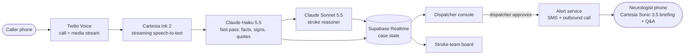

# LastWell

**Stroke alerts that start on the 911 call.**

LastWell is a voice agent that listens to a 911 medical call and recognizes a likely stroke from what the caller says and how they sound. It then pins down the one fact that decides treatment: when the patient was last seen normal. When the dispatcher approves with one click, it briefs the hospital stroke team by voice before the ambulance has even arrived.

Built at **Cal Hacks 13.0** (October 2026).

> **Status:** in progress. Everything below describes what we are building this weekend, and results marked _TBD_ will be filled in as they come.

---

## Why

Clot-dissolving IV tPA has to be given within **4.5 hours of the time the patient was last known well**, and treating earlier gives better outcomes. Three things slow treatment down before the patient reaches a CT scanner:

1. **The call often doesn't sound like a stroke.** Callers describe confusion, a fall, dizziness, or "he sounds drunk." In a Copenhagen study of more than 1.5 million emergency calls, human call handlers recognized 52.7% of strokes.
2. **The hospital hears late, or not at all.** Paramedics pre-alerted the hospital for only 67% of EMS-transported stroke patients in a US registry of 371,988 patients.
3. **Details get lost between the call and the ambulance.** The caller often knows exactly when Dad was last normal. That fact needs to survive every hand-off.

A pre-alert sent during the call could reach the stroke team an estimated **7 to 23 minutes earlier** than one sent from the scene in a median call. This is an estimate from national EMS timing medians that we still need to verify for strokes.

## What it does

LastWell has two screens and one phone call.

### Dispatcher console
- **Live transcript** of both sides of the call, with words that point to stroke underlined as they appear.
- **Stroke likelihood card** with a level (none yet / possible / likely). It shows the BE-FAST signs heard so far (balance, eyes, face, arms, speech, time) and the exact caller quote behind each one.
- **Next question** prompts, one at a time. For example: _"Ask: when was he last seen completely normal?"_
- **Look-alike check** for other things that could explain the call (low blood sugar, intoxication, seizure), with the question that would tell them apart.
- **Critical facts** collected during the call: last known well, blood thinners, age, diabetes, address.
- **One button: Send stroke pre-alert.** Nothing leaves the 911 center until the dispatcher presses it.

### Stroke-team voice briefing
When the dispatcher approves, the on-call stroke neurologist's phone rings and a 20-second voice briefing plays:

> "Stroke pre-alert from 911. 78-year-old man, right-sided weakness and slurred speech per his wife. Last seen normal at 2:10 PM, 47 minutes ago. Wife says he takes Eliquis. Ambulance dispatched."

The neurologist can then ask questions out loud. LastWell answers only from the call, and says _"That wasn't mentioned on the call"_ when it doesn't know. A text message carries the same facts.

### Stroke-team board
- One card per incoming pre-alert, with the facts, their quotes, and the time since last known well.
- A countdown to the 4.5-hour mark from last known well.
- A status that upgrades when paramedics confirm on scene, so the hospital can tell a dispatcher pre-alert apart from a paramedic-confirmed one.

## How it works



**Two speeds of reasoning.**
- **Fast pass:** Claude Haiku 5.5 reads each utterance within about a second and pulls out facts and quotes. This keeps the console live.
- **Slow pass:** Claude Sonnet 5.5 re-reads the whole transcript every ~10 seconds, or as soon as a new sign appears. It decides the likelihood level, the look-alikes and the next question. This keeps the judgment careful.

**Output contract.** Both passes return JSON that the console validates. Every sign and fact must carry the quote and timestamp it came from, and **anything without a quote is dropped**.

```json
{
  "level": "likely",
  "signs": [
    {"sign": "speech", "quote": "his words are all mixed up", "t": "00:41"},
    {"sign": "arms", "quote": "he can't lift his coffee cup", "t": "00:58"}
  ],
  "last_known_well": {"phrase": "he was fine at lunch, around two", "t": "01:12"},
  "blood_thinner": {"value": "Eliquis", "quote": "he's on Eliquis", "t": "01:30"},
  "lookalikes": [{"name": "low blood sugar", "ask": "Is he diabetic?"}],
  "next_question": "Ask whether he has diabetes."
}
```

**Time is computed by code, not by the model.** Claude only extracts the phrase ("around two", "about an hour ago"). A small parser turns it into a clock time using the call's start time. It keeps a range when the phrase is vague and always shows the original words beside the result.

## Tech stack

| Layer | Tools |
| --- | --- |
| Telephony | Twilio Voice (inbound call + media streams, outbound call, SMS) |
| Speech | Cartesia Ink 2 (streaming speech-to-text), Cartesia Sonic 3.5 (text-to-speech) |
| Reasoning | Claude Haiku 5.5 (fast extraction), Claude Sonnet 5.5 (stroke reasoning) |
| App | Next.js, TypeScript |
| Realtime state | Supabase Realtime |

### Cartesia features used
- **Ink 2** streaming speech-to-text with turn detection, listening to both sides of the 911 call.
- **Sonic 3.5** voice for the outbound stroke-team briefing.
- **Ink 2 + Sonic 3.5** together for the neurologist's live Q&A on the briefing call.

## Responsible design

| Risk | What LastWell does |
| --- | --- |
| False alarms → alert fatigue | Every alert needs dispatcher approval. A dispatcher pre-alert is kept separate from a paramedic-confirmed one. Precision is reported honestly. |
| Missed stroke → false reassurance | The card never says "not a stroke," only "No stroke signs heard yet." Normal dispatch protocol is untouched. |
| Invented facts | Every fact needs a quote and timestamp from the transcript, or it is dropped. The voice briefing answers "not mentioned" when it doesn't know. |
| Wrong last-known-well time | Claude extracts the phrase and code computes the time. The original words are always shown, and vague phrases stay ranges. |
| Accent or panic bias | The test set includes non-native speakers and panicked callers, and results are reported by group. |
| Automation bias | Prompts are questions to ask, never conclusions. The console has no "dispatch" button. |
| Privacy | The demo uses scripted calls only. The prototype does not store audio after the call. |

**What LastWell will never do:** dispatch units, change call priority, give medical instructions to the caller, or tell anyone "this is not a stroke."

## Evaluation

Real 911 recordings with stroke outcomes are not public, so we built a **scripted test set** of 38 calls. Teammates recorded them as audio so the full pipeline, speech-to-text included, gets tested.

| Call type | Count |
| --- | --- |
| Classic stroke | 10 |
| Stroke chameleon ("he's dizzy, probably just tired") | 8 |
| Look-alike, not stroke (low blood sugar, seizure, intoxication, migraine) | 8 |
| Other medical | 6 |
| Hard audio (non-native speaker, panicked caller, background noise) | 6 |

We compare LastWell against a keyword baseline that flags any call containing words like "stroke," "droop," "slurred" or "numb."

| Metric | LastWell | Keyword baseline |
| --- | --- | --- |
| Sensitivity (strokes flagged) | _TBD_ | _TBD_ |
| Precision (flags that were strokes) | _TBD_ | _TBD_ |
| Seconds into call at first flag | _TBD_ | _TBD_ |
| Last known well extracted correctly | _TBD_ | n/a |
| Blood thinner extracted correctly | _TBD_ | n/a |
| Invented facts (target: zero) | _TBD_ | n/a |

These are scripted calls, so the numbers will look better than real-world performance. For reference, the Copenhagen research model reached 63.0% recall and 24.9% precision on real calls.

## Getting started

_Setup instructions coming once the code lands._

You will need accounts and API keys for **Twilio**, **Cartesia**, **Anthropic** and **Supabase**. Keys go in a local `.env` file, which is git-ignored. Never commit keys.

## Known limitations

- No real 911 audio: all testing uses scripted and acted calls.
- Detection is imperfect. Even the published research model was right only about a quarter of the time it flagged a stroke, which is why a human approves every alert.
- English only for now.
- Time savings are an estimate from national EMS medians for chest pain, not stroke-specific data.
- Not reviewed for regulatory or security requirements that a real 911 or clinical deployment would need.

## What's next

- **Path to production:** retrospective testing on a 911 center's archived calls, then a shadow mode where dispatchers see nothing and flags are compared with outcomes, then a pre-alert pilot with one 911 center and one stroke center.
- Speech features (slurred speech, word-finding pauses) as a second signal.
- Routing to the right kind of stroke center when large-vessel stroke signs are reported.
- Spanish and Cantonese calls, both common in San Francisco.

---

> **Medical note:** LastWell is a hackathon prototype for decision support. Nothing in it is medical advice, and treatment decisions belong to the treating clinical team.
